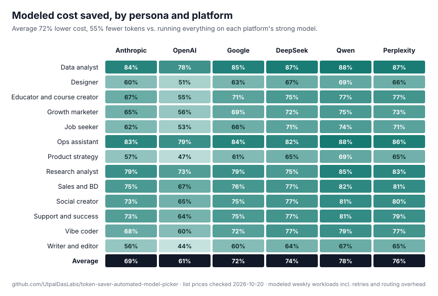

# Token Saver Skills

**Stop paying top-model prices for bottom-model work.** 18 open-source [Agent Skills](https://platform.claude.com/docs/en/agents-and-tools/agent-skills/overview) that send each AI task to the cheapest model that can actually finish it: a script, Haiku, Sonnet, Opus or Fable. One skill per way of working: vibe coding, social video, product, research, ops, marketing, writing, data, design, sales, support, teaching and job search.

| | Average across 13 personas | Pessimistic case |
|---|---:|---:|
| **Tokens saved** | <!-- AVG_TOKENS -->55%<!-- /AVG_TOKENS --> | <!-- CONS_TOKENS -->17%<!-- /CONS_TOKENS --> |
| **Cost saved** | <!-- AVG_COST -->69%<!-- /AVG_COST --> | <!-- CONS_COST -->54%<!-- /CONS_COST --> |

Compared with running every task on Claude Opus 5.5 at default effort with full context. Modeled with Anthropic list prices checked 2026-10-20, including the cost of failed attempts, escalations and the routing overhead itself. [How it's calculated](METHODOLOGY.md) · [Full results](benchmarks/RESULTS.md)



Built by [Utpal Das](https://utpaldas.com/labs/token-saver) · MIT licence.

## The idea in one table

| Tier | Runs on | Typical work | Price vs. Opus 5.5 |
|---|---|---|---|
| **T0** Tool | No model: script, formula, linter | Rename, dedupe, link check, format, maths | ~0 |
| **T1** Micro | Haiku 5.5 | Tag, extract, classify, summarise, short rewrite | ~1/40 |
| **T2** Standard | Sonnet 5.5 | Routine production from a clear spec | 1/2 |
| **T3** Strong | Opus 5.5 | Ambiguity, strategy, architecture, judging, final review | 1x |
| **T4** Frontier | Fable 5.1 | Rare: high stakes after Opus at high effort fell short | 2.5x |

Opus thinks, Sonnet produces, Haiku and scripts do the chores. Escalate one tier at a time, only after a check fails.

## Pick your skill

<!-- SAVINGS:START -->
| Skill | Who it's for | Tokens saved | Cost saved |
|---|---|---:|---:|
| [`data-analyst-routing`](skills/data-analyst-routing/SKILL.md) | Data and BI analysts | **79%** | **84%** |
| [`ops-assistant-routing`](skills/ops-assistant-routing/SKILL.md) | VAs, ops and chiefs of staff | **63%** | **83%** |
| [`research-analyst-routing`](skills/research-analyst-routing/SKILL.md) | Analysts, consultants, researchers | **33%** | **79%** |
| [`sales-bd-routing`](skills/sales-bd-routing/SKILL.md) | Sales and business development | **51%** | **75%** |
| [`social-creator-routing`](skills/social-creator-routing/SKILL.md) | Video and social media creators | **59%** | **73%** |
| [`support-success-routing`](skills/support-success-routing/SKILL.md) | Support and customer success | **54%** | **73%** |
| [`vibe-coder-routing`](skills/vibe-coder-routing/SKILL.md) | Indie hackers and AI-assisted builders | **65%** | **68%** |
| [`educator-creator-routing`](skills/educator-creator-routing/SKILL.md) | Teachers and course creators | **56%** | **67%** |
| [`growth-marketer-routing`](skills/growth-marketer-routing/SKILL.md) | Marketers, SEO and growth | **55%** | **65%** |
| [`job-seeker-routing`](skills/job-seeker-routing/SKILL.md) | Job seekers and career changers | **54%** | **62%** |
| [`designer-routing`](skills/designer-routing/SKILL.md) | UX and UI designers | **55%** | **60%** |
| [`product-strategy-routing`](skills/product-strategy-routing/SKILL.md) | Product managers and founders | **43%** | **57%** |
| [`writer-editor-routing`](skills/writer-editor-routing/SKILL.md) | Writers, newsletter authors, editors | **45%** | **56%** |
| **Average** | 13 personas | **55%** | **69%** |
<!-- SAVINGS:END -->

Shared foundation and overlays:

| Skill | What it does |
|---|---|
| [`base-model-routing`](skills/base-model-routing/SKILL.md) | The tier ladder, scoring rubric, escalation rules and brief template every persona skill extends |
| [`cheap-batch-mode`](skills/cheap-batch-mode/SKILL.md) | Bulk jobs: sample, script first, Haiku in chunks, rerun failures only |
| [`judge-best-output`](skills/judge-best-output/SKILL.md) | Generate variants cheaply, let Opus rank and pick the winner |
| [`high-stakes-review`](skills/high-stakes-review/SKILL.md) | Forces an Opus review before anything public, irreversible or regulated ships |
| [`context-diet`](skills/context-diet/SKILL.md) | Cuts input tokens: scope, summarise once, compact, cache-friendly prefixes |

## Install

### Claude Code (automatic model switching)

```bash
git clone https://github.com/UtpalDasLabs/token-saver-skills.git
cd token-saver-skills
./install.sh                      # all skills + subagents into ~/.claude
./install.sh vibe-coder-routing   # or just the base, overlays and one persona
```

This copies the skills to `~/.claude/skills/` and three subagents to `~/.claude/agents/`: `micro-worker` (Haiku, low effort), `standard-worker` (Sonnet, medium) and `strong-reviewer` (Opus, high). The skills tell the main session to delegate down to them. Check with `/skills` and `/agents`.

### Claude.ai

Download a skill zip from [Releases](https://github.com/UtpalDasLabs/token-saver-skills/releases), then upload it under **Customize → Skills → + → Upload a skill**. In chat, the skill prints a routing plan and tells you which model to switch to for each step.

### API and agent frameworks

[`routing.json`](routing.json) holds every persona's routing table with tier → model ID mapping. Load it in your router and pick the model per task type.

### Any other Agent Skills host

Each folder in `skills/` is a standard `SKILL.md` skill. Copy or zip the folder as your host expects.

## What a skill does in practice

Ask: "Turn my 25-minute YouTube video into 5 Reels with captions and hashtags, and tell me which to post first." With `social-creator-routing` loaded, the agent plans before it spends:

```text
ROUTING PLAN
1. [T1] haiku/low      Clean transcript, keep timestamps
2. [T1] haiku/low      Summarise into 12 key moments with timestamps
3. [T2] sonnet/medium  Draft 5 Reels: in/out times, hook, on-screen text
4. [T2] sonnet/low     3 caption variants per Reel
5. [T1] haiku/low      Hashtags + alt text per Reel (batch of 5)
6. [T3] opus/medium    Rank the 5 Reels and pick the first to post, with reason
7. [T0] script         Rename clip files, build upload CSV
```

## Where the savings come from

1. **Routing**: most weekly tasks are routine. Moving them from Opus to Sonnet (half the price) or Haiku (1/40) is where the cost saving comes from. It holds up even in the pessimistic case.
2. **Context diet**: sending a worker 5k tokens of relevant context instead of 40k of conversation is where the token saving comes from. It depends on discipline, which is why the pessimistic number is much lower.
3. **No model at all**: renames, link checks, CSV cleanup and arithmetic run as scripts.

Not counted, and stacking on top: prompt caching (cache reads cost 5% of input on Opus 5.5 and Sonnet 5.5) and the Batch API (50% off for work that can wait).

## Measure your own

The numbers above come from modeled weekly workloads in [`data/personas/`](data/personas). Edit the task counts and token sizes to match your week, then:

```bash
pip install pyyaml
python3 benchmarks/calculate.py   # prints savings, writes benchmarks/RESULTS.md
python3 tools/build.py            # regenerates the skills and this table
```

For real numbers, run the same week of work with and without the skill and compare your [Claude Console](https://platform.claude.com) usage. PRs with measured results are very welcome.

## Repo layout

```text
skills/            18 Agent Skills (SKILL.md each)
agents/            Claude Code subagents for T1, T2, T3
data/personas/     Workload + routing data per persona (single source of truth)
benchmarks/        Pricing, assumptions, calculator, results
routing.json       Machine-readable routing tables
install.sh         Claude Code installer
```

## Contributing

Add a persona by copying a file in `data/personas/`, running the two commands above, and opening a PR. Keep task counts realistic and explain any change to the assumptions.

## Licence

MIT. Prices change; re-check [Anthropic's pricing page](https://platform.claude.com/docs/en/about-claude/pricing) before quoting numbers.
