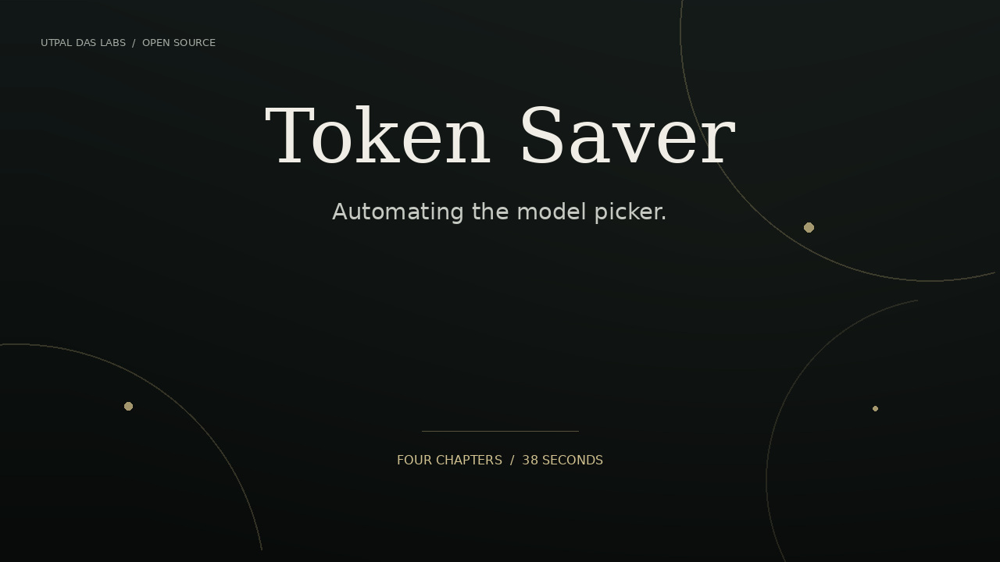

# Token Saver: Automating the Model Picker

**Stop paying top-model prices for bottom-model work.** An open-source pack of [Agent Skills](https://agentskills.io) that picks the model for you: each AI task goes to the cheapest model that can actually finish it — a script, a small model, a mid model or the flagship — and moves up only when a check fails.

Packaged for **Anthropic, OpenAI, Google, DeepSeek, Qwen, Perplexity and Kimi**, with one skill for each of 13 ways of working: vibe coding, social video, product, research, ops, marketing, writing, data, design, sales, support, teaching and job search.

| Modeled across 7 platforms × 13 personas | Average | Pessimistic case |
|---|---:|---:|
| **Cost saved** | **68%** | 51% |
| **Tokens saved** | **55%** | 17% |

Cost savings range from 28% to 88% depending on persona and platform. Compared with running every task on each platform's strong everyday model with full context, including failed attempts, escalations and the routing overhead itself. [How it's calculated](METHODOLOGY.md) · [Every persona on every platform](benchmarks/RESULTS.md) · [Website](https://utpaldas.com/labs/token-saver)

## Watch the product demo

[](docs/Token-Saver-Product-Demo.mp4)

[Watch the 38-second demo](docs/Token-Saver-Product-Demo.mp4): the cost problem, smart model routing, platform and workflow selection, and the modeled savings.


---

## Find your package in 3 steps

1. **Pick your platform** — the AI you already pay for.
2. **Pick your persona** — the row that sounds like your week.
3. **Install** `base-model-routing` + your persona skill (zip link in the cell, or `./install.sh <platform> <persona>`).

Each cell shows the modeled **cost saving** for that persona on that platform. Click the percentage for the skill file, or **zip** to download it.

| Persona | Who it's for | [Anthropic](platforms/anthropic/README.md) | [OpenAI](platforms/openai/README.md) | [Google](platforms/google/README.md) | [DeepSeek](platforms/deepseek/README.md) | [Qwen](platforms/qwen/README.md) | [Perplexity](platforms/perplexity/README.md) | [Kimi](platforms/kimi/README.md) |
|---|---|---|---|---|---|---|---|---|
| **Data analyst** | Data and BI analysts | [**−84%**](skills/anthropic/data-analyst-routing/SKILL.md) · [zip](dist/anthropic/data-analyst-routing.zip) | [**−78%**](skills/openai/data-analyst-routing/SKILL.md) · [zip](dist/openai/data-analyst-routing.zip) | [**−85%**](skills/google/data-analyst-routing/SKILL.md) · [zip](dist/google/data-analyst-routing.zip) | [**−87%**](skills/deepseek/data-analyst-routing/SKILL.md) · [zip](dist/deepseek/data-analyst-routing.zip) | [**−88%**](skills/qwen/data-analyst-routing/SKILL.md) · [zip](dist/qwen/data-analyst-routing.zip) | [**−87%**](skills/perplexity/data-analyst-routing/SKILL.md) · [zip](dist/perplexity/data-analyst-routing.zip) | [**−73%**](skills/kimi/data-analyst-routing/SKILL.md) · [zip](dist/kimi/data-analyst-routing.zip) |
| **Designer** | UX and UI designers | [**−60%**](skills/anthropic/designer-routing/SKILL.md) · [zip](dist/anthropic/designer-routing.zip) | [**−51%**](skills/openai/designer-routing/SKILL.md) · [zip](dist/openai/designer-routing.zip) | [**−63%**](skills/google/designer-routing/SKILL.md) · [zip](dist/google/designer-routing.zip) | [**−67%**](skills/deepseek/designer-routing/SKILL.md) · [zip](dist/deepseek/designer-routing.zip) | [**−69%**](skills/qwen/designer-routing/SKILL.md) · [zip](dist/qwen/designer-routing.zip) | [**−66%**](skills/perplexity/designer-routing/SKILL.md) · [zip](dist/perplexity/designer-routing.zip) | [**−45%**](skills/kimi/designer-routing/SKILL.md) · [zip](dist/kimi/designer-routing.zip) |
| **Educator and course creator** | Teachers and course creators | [**−67%**](skills/anthropic/educator-creator-routing/SKILL.md) · [zip](dist/anthropic/educator-creator-routing.zip) | [**−55%**](skills/openai/educator-creator-routing/SKILL.md) · [zip](dist/openai/educator-creator-routing.zip) | [**−71%**](skills/google/educator-creator-routing/SKILL.md) · [zip](dist/google/educator-creator-routing.zip) | [**−75%**](skills/deepseek/educator-creator-routing/SKILL.md) · [zip](dist/deepseek/educator-creator-routing.zip) | [**−77%**](skills/qwen/educator-creator-routing/SKILL.md) · [zip](dist/qwen/educator-creator-routing.zip) | [**−77%**](skills/perplexity/educator-creator-routing/SKILL.md) · [zip](dist/perplexity/educator-creator-routing.zip) | [**−45%**](skills/kimi/educator-creator-routing/SKILL.md) · [zip](dist/kimi/educator-creator-routing.zip) |
| **Growth marketer** | Marketers, SEO and growth | [**−65%**](skills/anthropic/growth-marketer-routing/SKILL.md) · [zip](dist/anthropic/growth-marketer-routing.zip) | [**−56%**](skills/openai/growth-marketer-routing/SKILL.md) · [zip](dist/openai/growth-marketer-routing.zip) | [**−69%**](skills/google/growth-marketer-routing/SKILL.md) · [zip](dist/google/growth-marketer-routing.zip) | [**−72%**](skills/deepseek/growth-marketer-routing/SKILL.md) · [zip](dist/deepseek/growth-marketer-routing.zip) | [**−75%**](skills/qwen/growth-marketer-routing/SKILL.md) · [zip](dist/qwen/growth-marketer-routing.zip) | [**−73%**](skills/perplexity/growth-marketer-routing/SKILL.md) · [zip](dist/perplexity/growth-marketer-routing.zip) | [**−44%**](skills/kimi/growth-marketer-routing/SKILL.md) · [zip](dist/kimi/growth-marketer-routing.zip) |
| **Job seeker** | Job seekers and career changers | [**−62%**](skills/anthropic/job-seeker-routing/SKILL.md) · [zip](dist/anthropic/job-seeker-routing.zip) | [**−53%**](skills/openai/job-seeker-routing/SKILL.md) · [zip](dist/openai/job-seeker-routing.zip) | [**−66%**](skills/google/job-seeker-routing/SKILL.md) · [zip](dist/google/job-seeker-routing.zip) | [**−71%**](skills/deepseek/job-seeker-routing/SKILL.md) · [zip](dist/deepseek/job-seeker-routing.zip) | [**−74%**](skills/qwen/job-seeker-routing/SKILL.md) · [zip](dist/qwen/job-seeker-routing.zip) | [**−71%**](skills/perplexity/job-seeker-routing/SKILL.md) · [zip](dist/perplexity/job-seeker-routing.zip) | [**−42%**](skills/kimi/job-seeker-routing/SKILL.md) · [zip](dist/kimi/job-seeker-routing.zip) |
| **Ops assistant** | VAs, ops and chiefs of staff | [**−83%**](skills/anthropic/ops-assistant-routing/SKILL.md) · [zip](dist/anthropic/ops-assistant-routing.zip) | [**−79%**](skills/openai/ops-assistant-routing/SKILL.md) · [zip](dist/openai/ops-assistant-routing.zip) | [**−84%**](skills/google/ops-assistant-routing/SKILL.md) · [zip](dist/google/ops-assistant-routing.zip) | [**−82%**](skills/deepseek/ops-assistant-routing/SKILL.md) · [zip](dist/deepseek/ops-assistant-routing.zip) | [**−88%**](skills/qwen/ops-assistant-routing/SKILL.md) · [zip](dist/qwen/ops-assistant-routing.zip) | [**−86%**](skills/perplexity/ops-assistant-routing/SKILL.md) · [zip](dist/perplexity/ops-assistant-routing.zip) | [**−56%**](skills/kimi/ops-assistant-routing/SKILL.md) · [zip](dist/kimi/ops-assistant-routing.zip) |
| **Product strategy** | Product managers and founders | [**−57%**](skills/anthropic/product-strategy-routing/SKILL.md) · [zip](dist/anthropic/product-strategy-routing.zip) | [**−47%**](skills/openai/product-strategy-routing/SKILL.md) · [zip](dist/openai/product-strategy-routing.zip) | [**−61%**](skills/google/product-strategy-routing/SKILL.md) · [zip](dist/google/product-strategy-routing.zip) | [**−65%**](skills/deepseek/product-strategy-routing/SKILL.md) · [zip](dist/deepseek/product-strategy-routing.zip) | [**−69%**](skills/qwen/product-strategy-routing/SKILL.md) · [zip](dist/qwen/product-strategy-routing.zip) | [**−65%**](skills/perplexity/product-strategy-routing/SKILL.md) · [zip](dist/perplexity/product-strategy-routing.zip) | [**−32%**](skills/kimi/product-strategy-routing/SKILL.md) · [zip](dist/kimi/product-strategy-routing.zip) |
| **Research analyst** | Analysts, consultants, researchers | [**−79%**](skills/anthropic/research-analyst-routing/SKILL.md) · [zip](dist/anthropic/research-analyst-routing.zip) | [**−73%**](skills/openai/research-analyst-routing/SKILL.md) · [zip](dist/openai/research-analyst-routing.zip) | [**−79%**](skills/google/research-analyst-routing/SKILL.md) · [zip](dist/google/research-analyst-routing.zip) | [**−75%**](skills/deepseek/research-analyst-routing/SKILL.md) · [zip](dist/deepseek/research-analyst-routing.zip) | [**−85%**](skills/qwen/research-analyst-routing/SKILL.md) · [zip](dist/qwen/research-analyst-routing.zip) | [**−83%**](skills/perplexity/research-analyst-routing/SKILL.md) · [zip](dist/perplexity/research-analyst-routing.zip) | [**−28%**](skills/kimi/research-analyst-routing/SKILL.md) · [zip](dist/kimi/research-analyst-routing.zip) |
| **Sales and BD** | Sales and business development | [**−75%**](skills/anthropic/sales-bd-routing/SKILL.md) · [zip](dist/anthropic/sales-bd-routing.zip) | [**−67%**](skills/openai/sales-bd-routing/SKILL.md) · [zip](dist/openai/sales-bd-routing.zip) | [**−76%**](skills/google/sales-bd-routing/SKILL.md) · [zip](dist/google/sales-bd-routing.zip) | [**−77%**](skills/deepseek/sales-bd-routing/SKILL.md) · [zip](dist/deepseek/sales-bd-routing.zip) | [**−82%**](skills/qwen/sales-bd-routing/SKILL.md) · [zip](dist/qwen/sales-bd-routing.zip) | [**−81%**](skills/perplexity/sales-bd-routing/SKILL.md) · [zip](dist/perplexity/sales-bd-routing.zip) | [**−43%**](skills/kimi/sales-bd-routing/SKILL.md) · [zip](dist/kimi/sales-bd-routing.zip) |
| **Social creator** | Video and social media creators | [**−73%**](skills/anthropic/social-creator-routing/SKILL.md) · [zip](dist/anthropic/social-creator-routing.zip) | [**−65%**](skills/openai/social-creator-routing/SKILL.md) · [zip](dist/openai/social-creator-routing.zip) | [**−75%**](skills/google/social-creator-routing/SKILL.md) · [zip](dist/google/social-creator-routing.zip) | [**−77%**](skills/deepseek/social-creator-routing/SKILL.md) · [zip](dist/deepseek/social-creator-routing.zip) | [**−81%**](skills/qwen/social-creator-routing/SKILL.md) · [zip](dist/qwen/social-creator-routing.zip) | [**−80%**](skills/perplexity/social-creator-routing/SKILL.md) · [zip](dist/perplexity/social-creator-routing.zip) | [**−48%**](skills/kimi/social-creator-routing/SKILL.md) · [zip](dist/kimi/social-creator-routing.zip) |
| **Support and success** | Support and customer success | [**−73%**](skills/anthropic/support-success-routing/SKILL.md) · [zip](dist/anthropic/support-success-routing.zip) | [**−64%**](skills/openai/support-success-routing/SKILL.md) · [zip](dist/openai/support-success-routing.zip) | [**−75%**](skills/google/support-success-routing/SKILL.md) · [zip](dist/google/support-success-routing.zip) | [**−77%**](skills/deepseek/support-success-routing/SKILL.md) · [zip](dist/deepseek/support-success-routing.zip) | [**−81%**](skills/qwen/support-success-routing/SKILL.md) · [zip](dist/qwen/support-success-routing.zip) | [**−79%**](skills/perplexity/support-success-routing/SKILL.md) · [zip](dist/perplexity/support-success-routing.zip) | [**−47%**](skills/kimi/support-success-routing/SKILL.md) · [zip](dist/kimi/support-success-routing.zip) |
| **Vibe coder** | Indie hackers and AI-assisted builders | [**−68%**](skills/anthropic/vibe-coder-routing/SKILL.md) · [zip](dist/anthropic/vibe-coder-routing.zip) | [**−60%**](skills/openai/vibe-coder-routing/SKILL.md) · [zip](dist/openai/vibe-coder-routing.zip) | [**−72%**](skills/google/vibe-coder-routing/SKILL.md) · [zip](dist/google/vibe-coder-routing.zip) | [**−77%**](skills/deepseek/vibe-coder-routing/SKILL.md) · [zip](dist/deepseek/vibe-coder-routing.zip) | [**−79%**](skills/qwen/vibe-coder-routing/SKILL.md) · [zip](dist/qwen/vibe-coder-routing.zip) | [**−77%**](skills/perplexity/vibe-coder-routing/SKILL.md) · [zip](dist/perplexity/vibe-coder-routing.zip) | [**−50%**](skills/kimi/vibe-coder-routing/SKILL.md) · [zip](dist/kimi/vibe-coder-routing.zip) |
| **Writer and editor** | Writers, newsletter authors, editors | [**−56%**](skills/anthropic/writer-editor-routing/SKILL.md) · [zip](dist/anthropic/writer-editor-routing.zip) | [**−44%**](skills/openai/writer-editor-routing/SKILL.md) · [zip](dist/openai/writer-editor-routing.zip) | [**−60%**](skills/google/writer-editor-routing/SKILL.md) · [zip](dist/google/writer-editor-routing.zip) | [**−64%**](skills/deepseek/writer-editor-routing/SKILL.md) · [zip](dist/deepseek/writer-editor-routing.zip) | [**−67%**](skills/qwen/writer-editor-routing/SKILL.md) · [zip](dist/qwen/writer-editor-routing.zip) | [**−65%**](skills/perplexity/writer-editor-routing/SKILL.md) · [zip](dist/perplexity/writer-editor-routing.zip) | [**−35%**](skills/kimi/writer-editor-routing/SKILL.md) · [zip](dist/kimi/writer-editor-routing.zip) |

Not sure which persona? Pick the one whose most frequent task matches yours; you can install several. The four overlays (`cheap-batch-mode`, `judge-best-output`, `high-stakes-review`, `context-diet`) work with any persona.

## Platforms

| Platform | Tools covered | T1 → T3 models | Avg cost saved | Avg tokens saved | Guide |
|---|---|---|---:|---:|---|
| **Anthropic** | Claude Code, Claude.ai, Claude API | Claude Haiku 5.5 → Claude Sonnet 5.5 → Claude Opus 5.5 | **69%** | 55% | [Install guide](platforms/anthropic/README.md) |
| **OpenAI** | Codex (CLI, IDE, app), ChatGPT, OpenAI API | GPT-6 Luna → GPT-6.1 Sol (low effort) → GPT-6.1 Sol | **61%** | 56% | [Install guide](platforms/openai/README.md) |
| **Google** | Gemini CLI, Gemini API and Managed Agents | Gemini 3.1 Flash-Lite → Gemini 3.8 Flash → Gemini 4 Argon | **72%** | 55% | [Install guide](platforms/google/README.md) |
| **DeepSeek** | DeepSeek Harness, Claude Code or Codex on the DeepSeek API, DeepSeek API | DeepSeek V4.1 Flash (non-thinking) → DeepSeek V4.1 Flash (thinking) → DeepSeek V4 Pro | **74%** | 55% | [Install guide](platforms/deepseek/README.md) |
| **Qwen** | Qwen Code, Model Studio API | Qwen3.7-Flash → Qwen3.7-Plus → Qwen3.8-Max | **78%** | 55% | [Install guide](platforms/qwen/README.md) |
| **Perplexity** | Perplexity Computer, Perplexity Agent API | GPT-6 Luna → Gemini 3.8 Flash → Claude Opus 5.5 | **76%** | 55% | [Install guide](platforms/perplexity/README.md) |
| **Kimi** | Kimi Code, Kimi API | Kimi K3.1 Pro (low effort) → Kimi K3.1 Pro → Kimi K3.1 Pro | **45%** | 55% | [Install guide](platforms/kimi/README.md) |

Each platform guide lists its model tiers, verified prices, install steps for every tool, and downloads.

## How it works

Every skill uses the same five-step ladder, mapped to each platform's models:

| Tier | Role | Anthropic | OpenAI | Google | DeepSeek | Qwen | Perplexity | Kimi |
|---|---|---|---|---|---|---|---|---|
| **T0** | Scripts and tools, no model | — | — | — | — | — | — | — |
| **T1** | Micro: tag, extract, summarise | Haiku 5.5 | GPT-6 Luna | Gemini 3.1 Flash-Lite | V4.1 Flash | Qwen3.7-Flash | GPT-6 Luna | K3.1 Pro (low) |
| **T2** | Standard: production from a clear spec | Sonnet 5.5 | GPT-6.1 Sol (low effort) | Gemini 3.8 Flash | V4.1 Flash (thinking) | Qwen3.7-Plus | Gemini 3.8 Flash | K3.1 Pro |
| **T3** | Strong: judgement, strategy, review | Opus 5.5 | GPT-6.1 Sol | Gemini 4 Argon | V4 Pro | Qwen3.8-Max | Claude Opus 5.5 | K3.1 Pro |
| **T4** | Frontier: rare, high stakes | Fable 5.1 | GPT-6 Astra | Argon (high thinking) | V4 Pro (max effort) | Qwen3.8-Max (thinking) | Claude Fable 5.1 | K3.1 Pro (max) |

The strong model thinks; the mid model produces; the small model and scripts do the chores. Escalate one tier at a time, only after a check fails. Anything public, irreversible or "which option is best" starts at T3.

**What a skill does in practice.** Ask: "Turn my 25-minute video into 5 Reels with captions and hashtags, and tell me which to post first." With `social-creator-routing` loaded, the agent plans before it spends:

```text
ROUTING PLAN
1. [T1] haiku/low       Clean transcript, keep timestamps
2. [T1] haiku/low       Summarise into 12 key moments with timestamps
3. [T2] sonnet/medium   Draft 5 Reels: in/out times, hook, on-screen text
4. [T2] sonnet/low      3 caption variants per Reel
5. [T1] haiku/low       Hashtags + alt text per Reel (batch of 5)
6. [T3] opus/medium     Rank the 5 Reels and pick the first to post, with reason
7. [T0] script          Rename clip files, build upload CSV
```

On OpenAI the same plan reads `luna/low`, `sol/medium`; on Qwen `flash/low`, `plus/medium`, `max/medium`; and so on.

## Install

```bash
git clone https://github.com/UtpalDasLabs/token-saver-automated-model-picker.git
cd token-saver-automated-model-picker
./install.sh <platform> [--tool <tool>] [persona-skill ...]
```

| You use | Command | Where it installs | Model switching |
|---|---|---|---|
| Claude Code | `./install.sh anthropic` | `~/.claude/skills`, `~/.claude/agents` | Automatic (subagents pin `haiku`/`sonnet`/`opus`) |
| Claude.ai | Upload a zip from `dist/anthropic/` | Customize → Skills | Skill tells you which model to pick |
| Codex | `./install.sh openai` | `~/.agents/skills`, `~/.codex/agents` | Automatic (custom agents pin model + reasoning effort) |
| ChatGPT | Add a zip from `dist/openai/` | Skills | Skill tells you which model to pick |
| Gemini CLI | `./install.sh google` | `~/.gemini/skills`, `~/.gemini/agents` | Automatic (subagents pin `model`) |
| Qwen Code | `./install.sh qwen` | `~/.qwen/skills`, `~/.qwen/agents` | Automatic (subagents pin `model`) |
| DeepSeek Harness | `./install.sh deepseek` | `~/.agents/skills` | Routing plan |
| Claude Code on the DeepSeek API | `./install.sh deepseek --tool claude-code` | `~/.claude/skills`, `~/.claude/agents` | Automatic (`deepseek-flash` / `deepseek-v4-pro`) |
| Perplexity Computer | Plugins → Add custom → Import plugin from GitHub → paste `https://github.com/UtpalDasLabs/token-saver-automated-model-picker/tree/main/dist/perplexity/plugin` | Your plugins | Routing plan |
| Kimi Code | `./install.sh kimi` | `~/.kimi-code/skills` (`PREFIX=.` for project skills) | Routing plan; choose model/effort with `/model` |
| Any API / agent framework | Read [`routing.json`](routing.json) | — | Your code picks the model per task |

Always install `base-model-routing` with a persona; the installer does this for you.

## Where the savings come from

1. **Routing** — most weekly tasks are routine. Moving them to a model that costs a fraction of the flagship is where the cost saving comes from. It holds up in the pessimistic case.
2. **Context diet** — sending a worker 5k tokens of relevant context instead of 40k of conversation is where the token saving comes from. It depends on discipline, which is why the pessimistic number is much lower.
3. **No model at all** — renames, link checks, CSV cleanup and arithmetic run as scripts.

The size of the saving depends on the price gap inside each platform. Qwen and Perplexity save the most because their small models are very cheap relative to their strong ones. Kimi has no supported cheaper micro model, so its savings come from tools, lower effort and smaller context. Prompt caching, batch and off-peak discounts are not counted and stack on top.

## Measure your own

The numbers come from modeled weekly workloads in [`data/personas/`](data/personas) and verified list prices in [`data/platforms/`](data/platforms). Edit them to match your week:

```bash
pip install pyyaml
python3 benchmarks/calculate.py   # recompute savings
python3 tools/build.py            # regenerate every skill, package, guide and this README
python3 tools/chart.py            # redraw the chart
```

For real numbers, run the same week with and without the skill and compare your provider's usage dashboard. PRs with measured before/after results are very welcome.

## Repo layout

```text
skills/<platform>/<skill>/SKILL.md   126 generated skills (18 per platform)
agents/<platform>/<tool>/            worker agents: Claude Code, Codex, Gemini CLI, Qwen Code
platforms/<platform>/README.md       install guide + savings per persona
dist/<platform>/*.zip                ready-to-upload zips (+ Perplexity plugin)
data/personas/*.yaml                 13 persona workloads and routing tables
data/platforms/*.yaml                7 platforms: tiers, models, prices, tools
templates/                           base skill, overlays, workers, this README
benchmarks/                          assumptions, calculator, results
routing.json                         machine-readable tiers + routing tables
```

## Contributing

Add a persona (copy a file in `data/personas/`) or a platform (copy a file in `data/platforms/`), run the three commands above, and open a PR. Keep task counts realistic, cite official price pages, and explain any change to the assumptions.

## Licence

MIT © Utpal Das. Built in [Labs](https://utpaldas.com/labs/token-saver). Prices change; every platform file links its official pricing page — re-check before quoting numbers.
